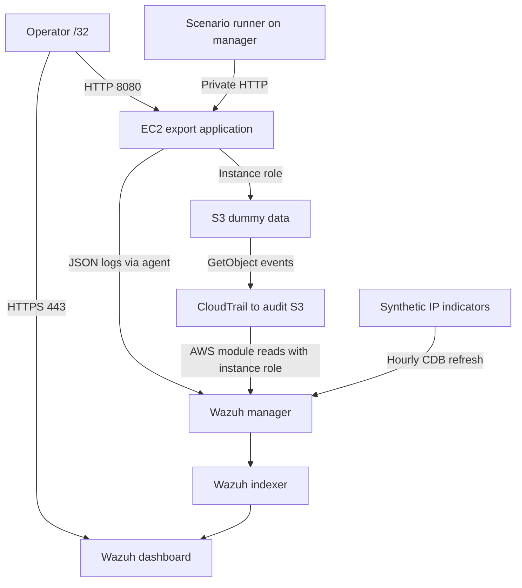

# Architecture and detection contract

This is a purpose-built lab, not an AWSGoat fork. It has one deliberate file-export authorization failure and an over-permissioned role scoped to a bucket containing only dummy data. The application simulates one persona whose permitted document is `public/report.csv`; it does not implement real user authentication.

The manager, indexer and dashboard run on one monitoring EC2 host. The scenario runner also runs there, through an explicitly triggered SSM command. Its private IP is inserted as a **synthetic test IOC**. This reduces the infrastructure to two hosts and provides a deterministic source address; this co-location is a demonstration compromise, not a recommended red/blue production topology.

Both hosts have public IPv4 addresses for package downloads and SSM connections. Inbound rules permit only the operator's /32, app-to-manager TCP 1514/1515, and manager-to-app TCP 8080. There is no SSH ingress, public Wazuh API, or public indexer. Outbound access is unrestricted in this lab so dependencies and AWS services work without NAT gateways. The app serves HTTP and synthetic data; the dashboard uses a self-signed HTTPS certificate. Neither is a production security configuration.

## Detection rules

| Rule | Condition | Meaning |
|---|---|---|
| 110002 | Any app export | Baseline export evidence |
| 110010 | Restricted export allowed | Behavioral authorization-failure alert, even for unknown IPs |
| 110011 | Restricted export denied | Application prevention evidence |
| 110012 | 110010 + CDB source-IP match | Behavioral alert with synthetic IOC context |
| 110013 | 110011 + CDB source-IP match | Denial with synthetic IOC context |
| 110020 | Unknown endpoint | Probe signal; alone does not prove malicious intent |
| 110021 | 110020 + CDB match | Probe with synthetic IOC context |
| 110030 | CloudTrail GetObject for lab restricted prefix | Object-read request observed; inspect outcome |
| 110031 | 110030 + AccessDenied | AWS permission denial |

Wazuh emits the matching child rule rather than separate parent and child alerts for one event. The evidence gate expects the enriched child IDs when using the manager's seeded IP.

The native JSON decoder handles application logs. The AWS module wraps CloudTrail in `integration=aws`, with `aws.source=cloudtrail`. The custom AWS rules extend vendor rule 80200. No bespoke application decoder is needed.

Application logs include a UTC timestamp, path, socket peer IP (forwarded headers are ignored), mode, outcome, object key, run ID, app request ID, and S3 request ID. Neither export contents nor credentials are logged. CloudTrail identifies the application role and its AWS request source, not the original HTTP caller. Join `s3_request_id` to CloudTrail `requestID`; timestamps alone are not accepted as correlation.

## Hardening

Deploy `mode=hardened`: Terraform replaces the application host to update its startup environment and changes its IAM policy to allow only `public/*` with an explicit denial for `restricted/*`. The existing Wazuh host and audit bucket remain when the bundle is unchanged. A new source bundle replaces both hosts; capture evidence before deploying code changes.

The verification scenario checks HTTP denial and independently calls S3 from the application host. It must still read the public file and receive exactly `AccessDenied` for the restricted file. It then joins that direct denial's request ID to CloudTrail. Because the application rejects the HTTP request before S3, expecting a CloudTrail event for that blocked HTTP request would be incorrect.

Blocking an IP is not included as an automated response. The defense is authorization and IAM hardening, supported by detection and investigation. No agent can be installed inside managed AWS S3; CloudTrail supplies that telemetry.
